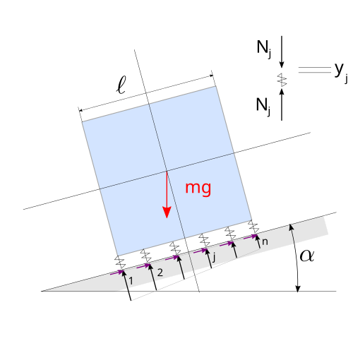

<!--
draft: true
-->

This post is the opportunity to answer a question on Physics SE treating (nearly)-rigid bodies as the limit case for infinite stiffness - and zero deformation - of deformable bodies, here elastic bodies. The question[^physics-se-question] wishes to investigate the distribution of reaction from the ground on a rigid cube on an inclined plane, and looks for the reason why in lots of textbooks the normal reaction is assumed to be linear in space. This post tries to provide a justification.

[^physics-se-question]: Physics Stack Exchange. [Distribution of floor reaction on inclined plane](https://physics.stackexchange.com/questions/877571/distribution-of-floor-reaction-on-inclined-plane).

{ #fig-force-diagram fig-align="center" }

Equilibrium conditions read

$$\left\{ \begin{aligned}
  0 & = \sum_i T_i - m g \sin \alpha = \mathbf{1}^T \mathbf{T} - mg \sin \alpha && \text{(parallel force)} \\
  0 & = \sum_i N_i - m g \cos \alpha = \mathbf{1}^T \mathbf{N} - mg \cos \alpha && \text{(normal   force)} \\
  0 & = \sum_i \ell_i N_i + m g \frac{\ell}{2} \sin \alpha - m g \ell_y \cos \alpha = \boldsymbol\ell^T \mathbf{N} - mg \ell \left( \frac{1}{2} \sin \alpha - a_y \cos \alpha \right)  && \text{(moment)} \,
\end{aligned} \right.$$

with the vector $\boldsymbol\ell$ containing the lever arms of the normal forces w.r.t. the reference point of the moment.

Let the normal forces be a linear functions of the local deformation of the medium, here modelled with lumped spring elements, with a linear relation between spring forces $\mathbf{N}$ and displacements $\mathbf{y}$, $\mathbf{N} = \mathbf{K} \mathbf{y}$, with $\mathbf{K}$ a symmetric stiffness matrix. The solution of the (hyperstatic) elastic problem follows from the [stationarity of the total potential energy](https://basics2022.github.io/bbooks-physics-continuum-mechanics/ch/solids/small-displacements-statics-weak-form-3d.html#principle-of-stationariety-of-total-potential-energy). Assuming "very small" deformation of the solid at the points of contact with the ground $|\mathbf{y}| \ll \ell$, the potential energy due gravitational field (and the boundary contributions) is negligible w.r.t. the elastic potential energy, 

$$\int_{V} \delta \mathbf{s} \cdot \overline{\mathbf{f}} \ll \int_{V} \delta \boldsymbol\varepsilon :  \boldsymbol\sigma =: U \ ,$$

and the principle of stationarity of total potential energy becomes the stationarity of the elastic potential of the system, subject to the equilibrium conditions

$$U(\mathbf{y}, \lambda_1, \lambda_2) := \frac{1}{2} \mathbf{y}^T \mathbf{K} \mathbf{y} - \lambda_1 \left( \mathbf{1}^T \mathbf{K} \mathbf{y} - Y_G \right) - \lambda_2 \left( \boldsymbol\ell^T \mathbf{K} \mathbf{y} - M_G \right) \ .$$

This problem is formulated as a constrained optimization problem. A stationarity point is determined by the conditions

$$\left\{\begin{aligned}
  \mathbf{0} & = \partial_{\mathbf{y}} U = \mathbf{K} \mathbf{y} - \mathbf{K} \mathbf{1} \lambda_1 - \mathbf{K} \boldsymbol\ell \lambda_2 \\ 
          0  & = \partial_{\lambda_1 } U = - \mathbf{1}^T \mathbf{K} \mathbf{y} + Y_G \\
          0  & = \partial_{\lambda_2 } U = - \boldsymbol\ell^T \mathbf{K} \mathbf{y} + M_G \ ,
\end{aligned}\right.$$

or using matrix formalism

$$\begin{bmatrix} \mathbf{K} & - \mathbf{K} \mathbf{1} & - \mathbf{K} \boldsymbol\ell \\ -\mathbf{1}^T \mathbf{K} & \cdot & \cdot \\ -\boldsymbol\ell^T \mathbf{K} & \cdot & \cdot \end{bmatrix} \begin{bmatrix} \mathbf{y} \\ \lambda_1 \\ \lambda_2 \end{bmatrix} = \begin{bmatrix} \mathbf{0} \\ -Y_G \\ -M_G \end{bmatrix} $$

Since - or if - the stiffness matrix is non-singular the first set of equations gives

$$\mathbf{y} = \lambda_1 \mathbf{1} + \lambda_2 \boldsymbol\ell \ .$$

Even without computing the values of the Lagrange multipliers $\lambda_1$, $\lambda_2$, this is the required result to justify a linear distribution of the normal reaction from the floor: since the components of the arm vector $\boldsymbol\ell$ are $\ell_k = x_k$ the displacement of the $k^{\rm th}$ spring is

$$y_k = \lambda_1 + \lambda_2 x_k \ ,$$

i.e. the displacement of the springs is the sum of a constant term and a term linear in the coordinates parallel to the ground. If the springs are uncoupled, and the stiffness matrix is diagonal, then also the reaction from the floor is $1^{\rm st}$-degree in $x$. (**todo** *Is this condition necessary? Is it possible to get a linear relation - at least for inner springs - even with more general stiffness matrices? E.g. with the FEM stiffness matrix $2 \text{diag}(0) - 1 \text{diag}(-1) - 1 \text{diag}(+1)$?*)

In order to complete the solution of the problem, the expression of $\mathbf{y}$ as a function of Lagrange multipliers can be replaced in the original linear system, to get a $2 \times 2$ linear system

$$
\begin{bmatrix}
\mathbf{1}^T \mathbf{K} \mathbf{1} & \mathbf{1}^T \mathbf{K} \boldsymbol\ell \\
\boldsymbol\ell^T \mathbf{K} \mathbf{1} & \boldsymbol\ell^T \mathbf{K} \boldsymbol\ell
\end{bmatrix}
\begin{bmatrix} \lambda_1 \\ \lambda_2 \end{bmatrix} = 
\begin{bmatrix} Y_G \\ M_G \end{bmatrix} \ .
$$

whose solution is

$$\begin{aligned}
  \lambda_1 & = \frac{ k_{22} Y_G - k_{12} M_G}{k_{11} k_{22} - k_{12}^2} \\
  \lambda_2 & = \frac{-k_{12} Y_G + k_{11} M_G}{k_{11} k_{22} - k_{12}^2} \\
\end{aligned}$$

Now,

* if $\mathbf{K} = \text{diag}\{ k \}$, then $k_{11} = N k$, $k_{12} = n k \overline{\ell}$, $k_{22} = n k \overline{\ell^2}$, s.t. $\Delta = n^2 k^2 \left( \overline{\ell^2} - \overline{\ell}^2 \right)$,
* if the pole is at the mid-point of the side on the floor, $\overline{\ell} = 0$; the arm of the normal component of the weight is $a_y \ell = 0$,

then

$$\begin{aligned}
 \lambda_1 & = \frac{n k \overline{\ell^2}}{n^2 k^2 \overline{\ell^2}} m g \cos \alpha && = \frac{mg}{n k} \cos \alpha \\
 \lambda_2 & = \frac{n k }{n^2 k^2 \overline{\ell^2}} \frac{m g \ell}{2}   \sin \alpha && = \frac{mg \ell}{2 n k \overline{\ell^2}} \sin \alpha \\
\end{aligned}$$

so that

$$y_k = \frac{mg}{n k} \cos \alpha + x_k \frac{mg \ell}{2 n k \overline{\ell^2}} \sin \alpha \ .$$

**Check - equilibrium.** The reaction of the $j^{\rm th}$ spring is $N_j = k y_j$, so that the sum of normal force of the reactions from the floor is

$$\sum_{j=1}^{n} k \left( \frac{mg}{n k} \cos \alpha + x_j \frac{mg \ell}{2 n k \overline{\ell^2}} \sin \alpha \right) = mg \cos \alpha \ ,$$

since $\sum_j x_j = 0$. The sum of the moments of the reactions is

$$\sum_{j=1}^{n} k x_j \left( \frac{mg}{n k} \cos \alpha + x_j \frac{mg \ell}{2 n k \overline{\ell^2}} \sin \alpha \right) = \frac{1}{2} mg \ell \sin \alpha \ ,$$

since $\sum_{j=1}^{n} x_j^2 = n \overline{\ell^2}$.

**todo** 

* Link to [energy theorems in statics of structural mechanics](https://basics2022.github.io/bbooks-physics-continuum-mechanics/ch/solids/small-displacements-statics-weak-form-3d.html). E.g. *Among all the equilibrated fields, the congruent solution of an elastic problem is...*

