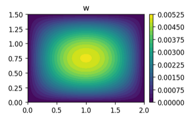
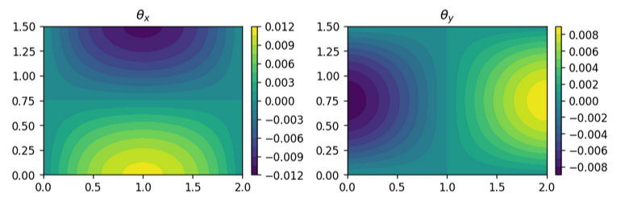
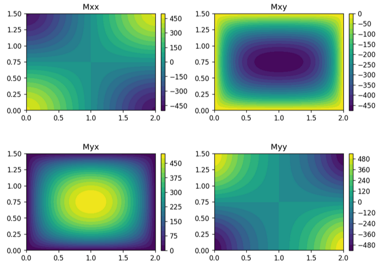
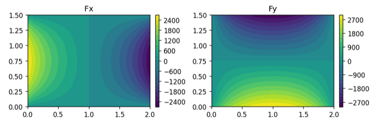
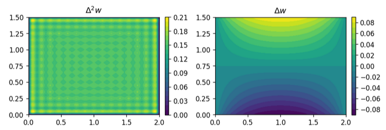

This article follows a post I've found on LinkedIn today, with a naive (better say **wrong**) use of tensor calculus operators to provide - let's say, try to provide - a detailed discussion of a Kirchhoff plate subject to transverse load, and the relation of other physical quantities to the spatial derivatives of the out-of-plane displacement field.

All the formulas are collected in the notes about continuum mechanics:

* [Kirchhoff  plate](https://basics2022.github.io/bbooks-physics-continuum-mechanics/ch/solids/plates-shells/kirchhoff.html)
* [Timoshenko plate](https://basics2022.github.io/bbooks-physics-continuum-mechanics/ch/solids/plates-shells/timoshenko.html)

Pictures are taken from the [analytical solution of the hinged rectangular plate](https://basics2022.github.io/bbooks-physics-continuum-mechanics/ch/solids/plates-shells/kirchhoff-analytic-sln.html) with a uniform distributed load, using Fourier basis. This analytical solution may be also an opportunity to discuss **Gibbs oscillations** close to the boundary.

# Bending of a Kirchhoff plate

The transverse displacement $w(x,y)$ of the a Kirchhoff plate subject to pure bending due to a transverse load $f_z(x,y)$ is governed by the differential equation

$$D \Delta \Delta w = f_z \ ,$$

supplemented with proper boundary conditions. The fourth-order differential equation is a Laplacian applied twice. As shown in the notes, the right interpretation of the space derivatives of the displacement field $w(\mathbf{r})$ is:

::: {layout="[1]"}

{#fig-kirchhoff-w}

:::

* **First derivative and small rotation.** The small rotation vector $\boldsymbol\theta$ is related to the gradient $\nabla w$

   $$\boldsymbol\theta = - \hat{\mathbf{z}} \times \nabla w \ .$$

::: {layout="[1]"}

{#fig-kirchhoff-theta}

:::

* **Second derivative and internal moment (tensor).** The Laplacian of the displacement field is the opposite of the $z$-component of the curl of the infinitesimal rotation

   $$\Delta w = - \hat{\mathbf{z}} \cdot \nabla \times \boldsymbol\theta \ .$$

   The moment tensor $\mathbb{M}$ - collecting all the information to get the internal moment acting on the elementary surface with (in-plane) unit vector $\hat{\mathbf{t}}$ as $\mathbf{M}_{\hat{\mathbf{t}}} = \hat{\mathbf{t}} \cdot \mathbb{M}$ - reads

   $$\begin{aligned} 
     \mathbb{M} 
     & = D \nabla \boldsymbol\theta - m D \nabla^T \boldsymbol\theta = \\
     & = D \begin{bmatrix} \cdot & 1 \\ -1 & \cdot \end{bmatrix} \nabla\nabla w - m D \nabla \nabla w \begin{bmatrix} \cdot & -1 \\ 1 & \cdot \end{bmatrix} \ ,
   \end{aligned}$$

   and thus the Laplacian of the out-of-plane displacement field is related to the internal moments as

   $$\Delta w = \frac{M_{yx} - M_{xy}}{(1+m) D} \ .$$

::: {layout="[1]"}

{#fig-kirchhoff-m}

:::

* **Third derivative and internal force in $z$-direction (vector).** The $z$-force vector $\mathbf{F}_z$ collecting all the information to get the internal force in $z$-direction acting on the elementary surface with (in-plane) unit vector $\hat{\mathbf{t}}$ as $F_{z,\hat{\mathbf{t}}} = \hat{\mathbf{t}} \cdot \mathbb{F}_z$ reads

   $$\mathbf{F}_z = D \begin{bmatrix} \cdot & 1 \\ -1 & \cdot \end{bmatrix} \Delta \boldsymbol\theta = - D \nabla \Delta w \ .$$

::: {layout="[1]"}

{#fig-kirchhoff-f}

:::

* **Fourth derivative and external load.** The external distributed load $f_z$ is proportional to the double Laplacian, as shown in the governing equation,

  $$f_z = - \nabla \cdot \mathbf{F}_z = D \Delta^2 w \ .$$

::: {layout="[1]"}

{#fig-kirchhoff-q-fourier-approx}

:::

Fourier basis for the hinged plate can't exactly relresent a uniform load, as the functions of the basis are identically zero on the boundary of the domain. While the approximation improves in most of the domain as the number of used basis functions increases, **Gibbs phenomenon** occurs at the boundary: sharp oscillations appears in a thin layer close to the domain.

