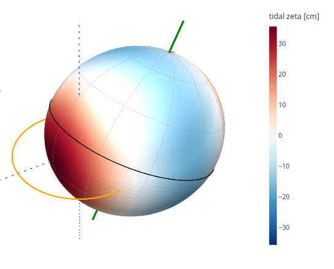

This series of posts is inspired by a recent video from *“La Fisica che non ti aspetti”* on tides and tidal forces. Because the material grew far larger than I initially expected when approaching the problem, I have split it into separate articles.

First, the dynamics of the Earth is formulated in the Earth–Moon system, taking its center of mass as the origin of an inertial reference frame. For a non-inertial observer on Earth, the combination of fictitious forces and the Moon's gravitational pull gives rise to the tidal force, which is first analyzed under the—quite rough—assumption of a static ocean, reducing the problem to fluid statics.

Dynamics is then introduced through a hierarchy of models of increasing complexity based on the shallow-water equations: first, the frequency response of a straight channel under external forcing is studied; next, the dynamics of an ocean covering the entire surface of an *aquaplanet* Earth in the Earth–Moon system is examined; finally, the evolution of an approximate model of a real basin is analyzed.

{ #fig-tides-static-ocean fig-align="center" }

