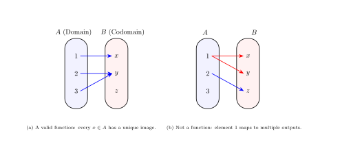
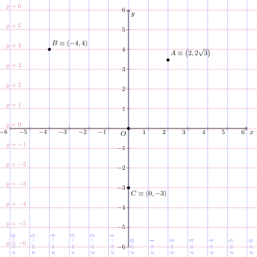
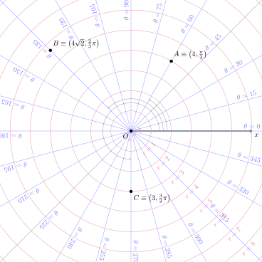
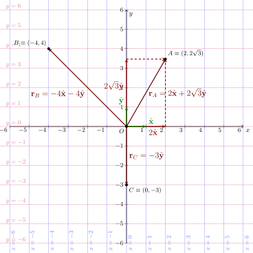

## Functions and Real Functions

**Definition of a function**. A function $f: A \rightarrow B$ is a relation between elements of 2 sets. It takes an element $a \in A$, and produces **one and only one** output $b = f(a)$. Sets $A$ and $B$ are respectively defined *domain* and *co-domain*. See [Insiemistica e funzioni](https://basics2022.github.io/bbooks-math-miscellanea-hs/ch/set).

{ #fig-function-sets fig-align="center" }

**Definition of a real function, $f: \mathbb{R} \rightarrow \mathbb{R}$**. A real function is nothing but a function, whose domain and co-domamin are subsets of the real numbers $\mathbb{R}$. See [Funzioni reali a variabile reale, $f: D \subseteq \mathbb{R} \rightarrow \mathbb{R}$](https://basics2022.github.io/bbooks-math-miscellanea-hs/ch/precalculus/real-functions.html).

**Definition of the graph of a real function**. Given a real function $f: D \subseteq \mathbb{R} \to \mathbb{R}$, its **graph** is the subset of the Cartesian plane $\mathbb{R}^2$ consisting of all points whose coordinates are $(x, f(x))$ as $x$ varies across the domain $D$:

$$\text{Graph}(f) = \{ (x, f(x)) \in \mathbb{R}^2 \mid x \in D \}$$

Visually, it is the "curve" or geometric shape drawn on the plane that translates the algebraic rule of the function into a picture. A point $(x_0, y_0)$ belongs to the graph if and only if $y_0 = f(x_0)$.

![Graphical representation in the Cartesian plane of (a) a real function and (b) a relation that's not a function. The relation representing a circle with Cartesian coordinate, $x^2 + y^2 = R^2$, can't be written as a function as there are two $y$ values associated to every individual value of $x \in [-R, R]$, i.e. $y = \mp \sqrt{R^2 - x^2}$.](function.svg){ #fig-function fig-align="center" }

Graph of functions will be useful later, to give a **geometrical interpretation** of **derivatives** and **integrals**.

## Introduction to Analytical Geometry

See [Math: Analytic geometry: Points in Plane: Coordinates](https://basics2022.github.io/bbooks-math-miscellanea-hs/ch/analytic_geometry/analytic_geometry_2d/coordinates.html)

Analytical geometry is a bridge between algebra and geometry. Points in space can be represented with a set of coordinates of a coordinate system.

Geometric entities and properties:

* are idependent (**invariant**) from the arbitrary choice of the coordinate system
* can be represented with algebraic relations between the coordinates, once a coordinate system is chosen

Coordinate systems are **for free**. It's possible to use more than one coordinate system in the same problem, if they help in the solution. Any additional coordinate system that's not helping with the solution only adds unnecessary algebra and increases the probability of making mistakes.

Just as an example, the points of the same circle with radius $R$ in a plane can be easily represented:

* using a system of Cartesian coordinates $(x,y)$ with the origin in the center of the circle, as $x^2 + y^2 = R^2$
* using a system of polar coordinates $r, \theta$, with the origin in the center of the circle, as $r = R$, for all $\theta \in [0, 2 \pi]$.

::: {layout="[1,1]"}

{#fig-plane-coordinates}

{#fig-plane-polar-coordinates}

:::

## Introduction to Vectors: Position Vectors

See [Math: Analytic geometry: Points in Plane: Position Vectors](https://basics2022.github.io/bbooks-math-miscellanea-hs/ch/analytic_geometry/analytic_geometry_2d/vectors.html)

We use geometry in Eulcidean space as a way to introduce **vectors**, very powerful mathematical tools in both math and physics: at the university, you'll learn that a lot of quantities of interest in math and physics are vector quantities, and (almost?) all the fundamental equations in physics are vector equations.

Once a point $O$ in an Euclidean space is set as a reference, the so called **origin**, then a point $P$ in the Euclidean space can be described with its **position vector** w.r.t. $O$, 

$$\vec{r}_P = \overrightarrow{OP} = P-O \, $$

that can be represented[^vector-arrow] as the arrow with extreme points $O$ and $P$, pointing from $O$ to $P$.

::: {layout="[1,1]"}

{#fig-plane-coordinates}

{#fig-plane-vectors}

:::

This is just a first look at vectors. Without too many details, a vector is nothing too strange:

- it's a **mathematical object**, just like numbers are
- with some mathematical properties
- that can be used to represent geometrical or physical quantities, that numbers alone can't fully represent. Examples of vector quantities are: velocity, acceleration, force,...**magnitude** of these physical quantities is not enough; we also need **direction**
- that can be combined with other vectors, through **vector operations (vector algebra)**. it's possible to multiply a vector by a number, it's possible to sum and subtract vectors, it's possible to define different kinds of products using vectors,...

[^vector-arrow]: The arrow is just a useful graphical representation of the vector, it's not the vector itself.

