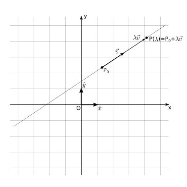
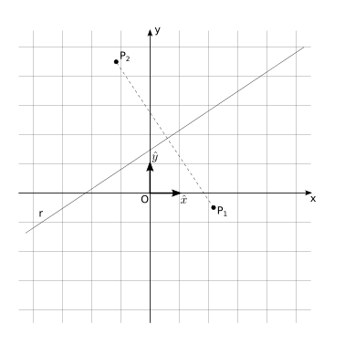
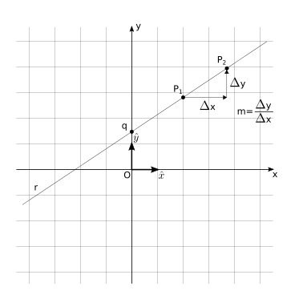

Introduce Cartesian basis and vector operations. Use it for defining lines with a point and a direction. Definition of point-to-point distance in Cartesian plane, and its application to define lines, and (almost every) conics: circles, ellipses, hyperbola.

## Vectors using a Cartesian basis

Cartesian basis:

Operations:

* Multiplication by a scalar

* Sum and difference of vectors

* Scalar (or inner) product

## Point-to-point distance

Using Cartesian coordinates, this is nothing more than the Pythagorean theorem. The distance of two points $P_1 \equiv (x_1, y_1)$, $P_2 \equiv (x_2, y_2)$, is the hypotenuse of the right triangle with catheti parallel to the Cartesian axes with length $|x_2 - x_1|$ and $|y_2-y_1|$. By Pythagorean theorem, the length of the hypotenusa, and thus the distance between the two points, is

$$d(P_1, P_2) = |P_2 - P_1| = \sqrt{(x_2-x_1)^2 + (y_2-y_1)^2} \ .$$

See:

* [Math: Analytic geometry: point-to-point distance](https://basics2022.github.io/bbooks-math-miscellanea-hs/ch/analytic_geometry/analytic_geometry_2d/points.html#distanza-tra-punti)

## Lines in plane

Different equivalent definitions

* Point and direction (*parametric equation*)
* Points with the same distance from two given points $P_1$, $P_2$, using the definition of point-point distance (*implicit equation*)
* Point and slope (*explicit equation*)

All the details are provided in:

* [Math: Anlyatical geometry: lines](https://basics2022.github.io/bbooks-math-miscellanea-hs/ch/analytic_geometry/analytic_geometry_2d/lines.html)

::: {layout="[1,1,1]"}

{#fig-line-param}

{#fig-line-impli}

{#fig-line-expli}

:::

## Conics in plane: circles, ellipses, hyperbola

The canonical form of the equations of circles, ellipses, and hyperbola can be easily derived using Cartesian coordinates just with the definition of **point-to-point distance** and a proper choice of the coordinate system. Only parabola is missing here, as it requires the point-to-line distance

This section only contains the conversion from the word definition to math. All the details - mainly boring algebra - are provided in

* [Math: Analytical geometry: conics](https://basics2022.github.io/bbooks-math-miscellanea-hs/ch/analytic_geometry/analytic_geometry_2d/conics.html)
* [Math: Analytical geometry: conics: cananonical form with Cartesian coordinates](https://basics2022.github.io/bbooks-math-miscellanea-hs/ch/analytic_geometry/analytic_geometry_2d/conics-cartesian.html)

**Circle.** The points of the circle have the same (point-to-point) distance from the center of the circle, equal to the radius $R$. Using Cartesian coordinates, the distance between points $P \equiv (x,y)$ of the circle and its center $C \equiv (x_C, y_C)$ is equal to the radius $R$, or in math

$$d(P, C) = \sqrt{(x-x_C)^2 + (y-y_C)^2} = R \ ,$$

or, squaring, the equation of the circle with center $C \equiv (x_C, y_C)$ and radius $R$ reads

$$(x-x_C)^2 + (y-y_C)^2 = R^2 \ .$$

**Ellipses.** An ellipse can be defined as the geometric entity in the plane whose points have constant sum of the distances w.r.t. given points, the foci $F_1$, $F_2$, i.e.

$$|P - F_1| + |P - F_2| = 2 c  \ .$$

**Ellipses.** A hyperbola can be defined as the geometric entity in the plane whose points have constant difference of the distances w.r.t. given points, the foci $F_1$, $F_2$, i.e.

$$\left| |P - F_1| - |P - F_2| \right| = 2 a  \ .$$

Here the absolute value is required on the right-hand-side, to represent both the branches of the hyperbola

